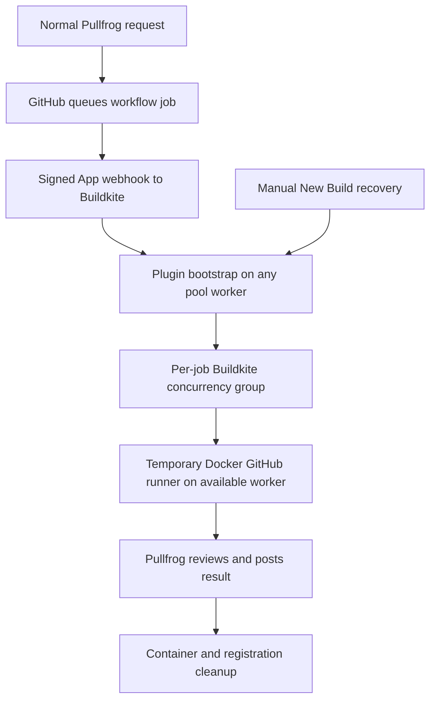

# GitHub runner Buildkite plugin

Run real, temporary GitHub Actions runners as jobs in an existing Buildkite
pool. Pullfrog's normal manual trigger is the first supported integration.

**Experimental first implementation.** Local contract tests cover provisioning
decisions, credentials, duplicate scheduling, and setup resumption. A live
GitHub → Buildkite → Pullfrog deployment has **not** been verified. See the
[project plan and acceptance gates](docs/PLAN.md) before deploying.

## What it does

1. Pullfrog starts its normal GitHub Actions workflow after a manual request.
2. GitHub sends a signed `workflow_job` event directly to Buildkite.
3. A short plugin bootstrap checks live GitHub state and uploads worker steps.
4. Any eligible Buildkite worker starts a fresh Docker GitHub runner.
5. GitHub assigns the job; Pullfrog uses real GitHub OIDC and posts the result.
6. The container is removed and the Buildkite slot is released.

There is no project-operated service, persistent coordinator, or scheduled idle
polling. Review execution occupies a normal pool slot. GitHub hosts the workflow
control plane; compute runs on the selected Buildkite pool.



## One guided setup command

Use the public repository containing this README as `OWNER` below. Examples
are placeholders, not existing accounts or repositories. There is no PyPI
release yet. With [uv](https://docs.astral.sh/uv/) installed:

```bash
uvx --from 'git+https://github.com/OWNER/github-runner-buildkite-plugin.git' \
  bk-runner-bridge setup \
  --source OWNER/github-runner-buildkite-plugin \
  --repo example/project \
  --buildkite-org example-org \
  --queue linux
```

For reproducibility, append `@FULL_COMMIT_SHA` to the Git source URL and pass
the same SHA with `--revision`. Setup pins the Buildkite plugin to a commit.
Review the selected source before granting setup access.

The installer discovers clusters/queues, creates a Buildkite pipeline and signed
incoming trigger, opens GitHub's preconfigured App registration page, stores the
App key in Buildkite Secrets, and opens a **draft workflow PR**. Account consent,
App installation and PR merging remain human decisions. Rerun the same command
to resume. Each independent installation needs its own `--state PATH`.

Requirements on the setup computer: Python 3.11+, GitHub CLI (`gh auth login`),
OpenSSL, and a browser on the same computer. Buildkite authentication currently
uses a securely prompted API token or `BUILDKITE_API_TOKEN`; device-code login
is a planned enhancement. Do not place tokens in command arguments.

Requirements on every eligible worker: **Linux x64**, Python 3.11+, OpenSSL,
Docker, Buildkite agent with plugins and Secrets access, outbound network access,
and working user/PID/mount namespaces. Pool membership and scaling remain yours.

Read the [installation guide](docs/INSTALL.md) for token scopes, browser consent,
container restrictions, Pullfrog setup, and verification. `setup --plan` performs
a read-only GitHub preflight and prints the proposed operations.

## Recovery without idle polling

- A qualifying queued event also scans that repository for stranded bridge jobs.
- Provisioning failures receive at most two Buildkite retries, with live state
  checked before each attempt. Completed reviews are never automatically rerun.
- Start **New Build** on the bridge pipeline's default branch to recover waiting
  jobs manually. No custom PR command is needed.
- A completely lost webhook cannot recover until another event or a manual
  recovery run occurs. GitHub does not automatically redeliver failed webhooks.

The plugin uses Buildkite concurrency groups, rather than a second runtime API
credential, to serialize requests. Duplicate deliveries can produce extra
Buildkite steps; those steps revalidate and exit without starting another review.

## Development

```bash
python3 -m unittest discover -s tests -v
python3 -m runner_bridge.cli --help
```

Tests use fake GitHub/Buildkite/Docker boundaries except for real OpenSSL JWT
verification. They do not prove live service compatibility. No CI account or
model subscription is needed to run them. The [architecture](docs/ARCHITECTURE.md),
[security model](SECURITY.md), and [project plan](docs/PLAN.md) describe boundaries
and outstanding acceptance tests.

Licensed under [MIT](LICENSE). This project is independent of GitHub, Buildkite,
Pullfrog and model providers.
